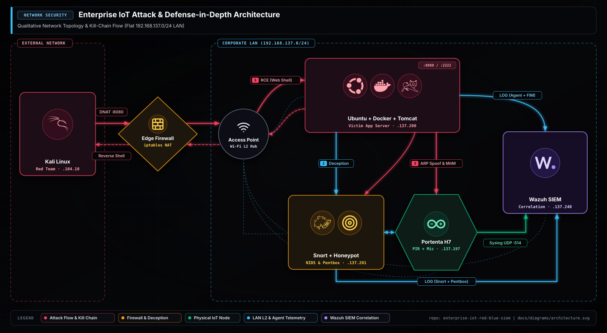

# Red & Blue Team Simulation in an Enterprise IoT Infrastructure

End-to-end **Cyber Kill Chain** simulation and **Defense-in-Depth** monitoring lab built for a Small-and-Medium Enterprise (SME) environment integrating physical IoT server-room sensing, containerized web services, perimeter filtering, network/host intrusion detection, cyber deception, and centralized SIEM correlation.

> **Course:** Network Security — University of Naples Federico II (DIETI), Academic Year 2025/2026  
> **Authors:** Giuseppe Ruggiero, Filomena Vigliotti

---

## 1. Threat Scenario & Lab Architecture

The lab models an SME flat corporate network (`192.168.137.0/24`) lacking DMZ/VLAN segmentation and exposing a legacy web application container behind an `iptables` edge router (`192.168.104.3` WAN / `192.168.137.254` LAN).



*[High-resolution PNG version](docs/diagrams/architecture.png)*

| Node | OS / Platform | Interface / Lab IP | Role |
| :--- | :--- | :--- | :--- |
| **Attacker** | Kali Linux 2024.2 | `192.168.104.10` | External Red Team workstation |
| **Edge Firewall** | Ubuntu 20.04.3 LTS (`iptables`) | `192.168.104.3` (WAN) / `192.168.137.254` (LAN) | Default `DROP` forwarding policy, selective SNAT/DNAT on TCP `8080` (and debug SSH DNAT on TCP `2222`) |
| **Victim App Server** | Ubuntu 24.04 CLI + Docker | `192.168.137.200` | Hosts privileged container running vulnerable **Apache Tomcat 8.0.43** + Wazuh Agent |
| **Defensive Probe** | Ubuntu 22.04 | `192.168.137.201` | Promiscuous **Snort** NIDS + **Pentbox** Honeypot (MAC spoofed as Raspberry Pi OUI) + Wazuh Agent |
| **Physical IoT Node** | Arduino Portenta H7 | `192.168.137.197` | PIR motion + acoustic server-room monitor, embedded HTTP dashboard, UDP syslog HIDS |
| **SIEM Server** | Wazuh 4.14.4 OVA | `192.168.137.240` | Centralized log collection, FIM, and custom correlation rules (`local_rules.xml`) |

---

## 2. Red Team Kill Chain Simulated

1. **External Reconnaissance:** Subnet ARP discovery and `nmap` enumeration from Kali Linux revealing the perimeter IP (`192.168.104.3`) and port-forwarded Apache Tomcat `8.0.43` on TCP `8080`.
2. **Initial Access & Exploitation:** Deployment of a custom `cmd.jsp` web shell packaged inside a decoy archive (`BustePaga.war` returning a cover HTTP `404` error page) via Tomcat Manager weak/default credentials.
3. **Container Escape & Privilege Escalation:** Discovery of privileged container execution (`root`), mounting of host block device (`/dev/sda2`) inside `/mnt/host_os`, inspection of `/etc/shadow` and Netplan configuration, offline password cracking via **John The Ripper** (`rockyou.txt`), and `chroot`-based host escape.
4. **Persistence & Defense Evasion (APT Path):** Space-free Base64 Bash reverse shell via brace expansion (`{echo,...}|{base64,-d}|{bash,-i}`), injection of an **ED25519** SSH key into `authorized_keys`, NAT-tunneled passwordless SSH over TCP `2222`, and shadow user injection into `/etc/passwd`.
5. **Internal Reconnaissance & Lateral Movement:** Internal discovery (`arp -a`, internal `nmap`) followed by bidirectional Layer-2 **ARP cache poisoning** (`arpspoof`) and cleartext HTTP interception (`tcpdump`) targeting both the Portenta H7 node and the honeypot decoy.

---

## 3. Blue Team Defense-in-Depth & Detection Stack

- **Network IDS (Snort):** Promiscuous packet capture across `HOME_NET` with custom signatures for internal reconnaissance, SYN/ICMP scans, and Layer-2 MITM indicators forwarded to Wazuh.
- **Cyber Deception (Pentbox Honeypot + MAC Spoofing):** Spoofed Raspberry Pi MAC OUI to appear as a genuine IoT node on `nmap`, fake `Unauthorized Access - IoT Control Panel` HTTP service on TCP `80`, deceptive debug honeytokens returned over intercepted MITM traffic, and real-time logging to `/var/log/pentbox_honeypot.log` (`INTRUSION ATTEMPT`).
- **Endpoint & Integrity Monitoring (Wazuh Agent + FIM):** Tracks unauthorized SSH logins (flagging anomalous source IPs) and triggers high-severity **File Integrity Monitoring (FIM)** checksum alerts upon `/etc/passwd` tampering.
- **Custom Wazuh Correlation Rules (`local_rules.xml`):**
  - `100002`: Triggers on Pentbox `INTRUSION ATTEMPT` events.
  - `100011`: Acoustic anomaly alert from `portenta_h7` syslog.
  - `100012`: Volumetric PIR motion intrusion alert from `portenta_h7` syslog.
  - `100020`: Correlates Snort scan/MITM alerts targeting the Portenta H7 IP.
  - `100030`: Correlates Snort scan/ARP alerts targeting the Pentbox honeypot IP.
- **IoT Host-Based Rate Protection (`Dashboard_Portenta_H7.ino`):**
  - Streams RFC-style UDP syslog telemetry (`ALERT`, `ERROR`, `INFO`) directly to Wazuh port `514` (`agentless` mode).
  - Enforces a 1-second HTTP rate window (`DOS_THRESHOLD = 3`), automatically switching to HTTP `503 Service Unavailable` and firing a DoS syslog alert upon threshold violation.

---

## 4. Repository Structure

```text
enterprise-iot-red-blue-siem/
├── docs/
│   └── diagrams/                          # Architecture & kill-chain flow diagrams
├── firmware/
│   └── Dashboard_Portenta_H7/
│       ├── Dashboard_Portenta_H7.ino      # Portenta H7 web dashboard, PIR/sound monitor & UDP syslog HIDS
│       └── arduino_secrets.h.example      # Template for local Wi-Fi, static IP & Wazuh syslog settings
├── .gitignore
└── README.md
```

---

## 5. Firmware Setup (Arduino Portenta H7)

1. Open [Dashboard_Portenta_H7.ino](firmware/Dashboard_Portenta_H7/Dashboard_Portenta_H7.ino) in **Arduino IDE**.
2. Copy `arduino_secrets.h.example` to `arduino_secrets.h` in `firmware/Dashboard_Portenta_H7/`:
   ```bash
   cp firmware/Dashboard_Portenta_H7/arduino_secrets.h.example firmware/Dashboard_Portenta_H7/arduino_secrets.h
   ```
3. Populate `SECRET_SSID`, `SECRET_PASS`, static IP octets, and `SECRET_WAZUH_IP` inside `arduino_secrets.h` (already excluded by `.gitignore`).
4. Wire the PIR motion sensor to pin `D3` and the acoustic sensor to pin `D4`, then flash onto the **Arduino Portenta H7 (M7 core)**.

### Hardening Improvements Applied
- **Credential isolation:** Wi-Fi credentials and infrastructure IPs extracted from source into `arduino_secrets.h`.
- **Non-blocking acoustic alert reset:** Acoustic detection (`soundDetected`) automatically re-arms after a 5-second cooldown even when no web browser polls the HTTP dashboard.
- **HTTP Slowloris & heap protection:** Bounded HTTP header buffer (`512` bytes), pre-reserved string capacity, 2-second client read timeout, and explicit `HTTP 413 Payload Too Large` rejection.

---

## 6. Architectural Lessons & Remediation Roadmap

This simulation intentionally demonstrates weak SME defaults; hardening a production equivalent requires:
1. **Network Segmentation:** Isolate exposed Tomcat services inside a **DMZ** and segregate IoT devices into dedicated **VLANs** with dynamic ARP inspection / DHCP snooping.
2. **Least Privilege & Container Hardening:** Run Docker containers as non-privileged users (`USER` directive, drop `CAP_*`), enforce password policies, and patch obsolete runtimes.
3. **Encrypted IoT Telemetry:** Migrate from plaintext HTTP polling to authenticated **MQTT over TLS (MQTTS)**.
4. **Wazuh Active Response:** Integrate SIEM alerts directly with `iptables` on the Edge Firewall to dynamically drop offending attacker IPs.

